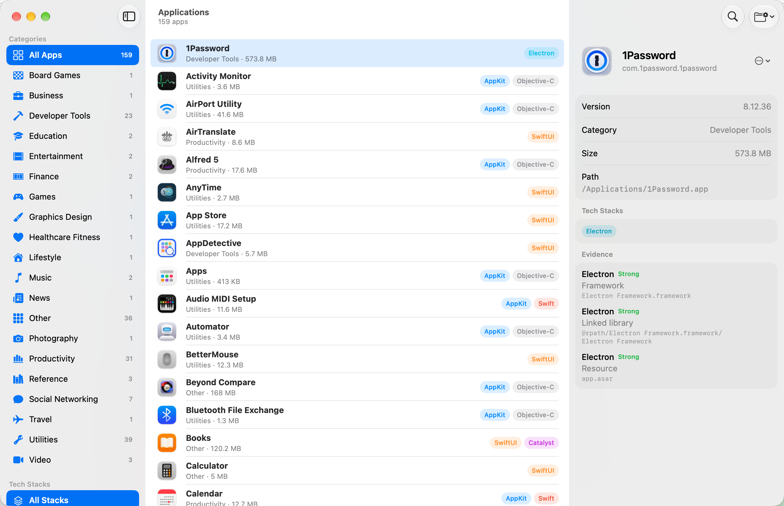

# App Detective

[](https://github.com/hewigovens/app-detective/actions/workflows/ci.yml)


App Detective identifies how macOS apps are built and shipped: their UI framework, language, renderer, graphics API, distribution, updater, security settings, and background items.



## Install

### Homebrew

```bash
brew tap hewigovens/tap
brew install --cask app-detective
```

## Command-line tool

App Detective ships with `appdetective`, a CLI for analyzing a single `.app` bundle.

Install it from inside the app: **App Detective → Install Command Line Tool…** symlinks `appdetective` into `~/.local/bin/`. If `~/.local/bin` isn't on your `PATH`, the install dialog tells you the line to add.

You can also start the app directly on a folder:

```bash
open -a "App Detective" --args --scan-folder /Applications
```

```bash
$ appdetective /Applications/Visual\ Studio\ Code.app
App:          Visual Studio Code.app
Path:         /Applications/Visual Studio Code.app
Bundle ID:    com.microsoft.VSCode
Version:      1.142.0 (1.142.0)
Size:         900 MB
Category:     Developer Tools
UI:           Electron
Distribution: Developer ID
Updater:      Squirrel
Security:     Hardened Runtime, Notarized
```

Use `--json` for machine-readable output (handy for scripts and agents), and `--explain` to see the evidence behind each trait:

```bash
$ appdetective --json /System/Applications/Calculator.app
{
  "build" : "225",
  "bundleId" : "com.apple.calculator",
  "category" : "Other",
  "name" : "Calculator.app",
  "path" : "/System/Applications/Calculator.app",
  "possibleTraits" : [ ],
  "sizeBytes" : 4954666,
  "sizeHuman" : "5 MB",
  "traits" : {
    "distribution" : [ "Apple" ],
    "language" : [ "Swift" ],
    "security" : [ "App Sandbox" ],
    "ui" : [ "SwiftUI" ]
  },
  "version" : "12.0"
}
```

## What It Detects

Each app gets a list of traits, grouped by kind.

### UI Frameworks
- Native: SwiftUI, AppKit, UIKit (iOS apps on Apple silicon), Catalyst
- Web runtimes: Electron, Chromium Embedded Framework, Microsoft Edge
- Cross-platform: Flutter, React Native, Qt, GTK, wxWidgets, Compose Multiplatform, Avalonia, Xamarin/MAUI, Xojo
- Rust and Go: Tauri, GPUI, Iced, egui, Slint, Wails, Fyne
- Runtimes: Java, Python
- Game engines: Unity, Unreal Engine

### Languages
- Swift, Objective-C, Rust, Go, found in the app's executable, its own frameworks, and its extensions

### Renderers
- wgpu, for apps that draw their own UI on the GPU

### Graphics APIs
- Metal, OpenGL, Vulkan (MoltenVK), from the libraries the app links or bundles

### Distribution
- App Store, TestFlight, Developer ID, Apple, ad-hoc signed, from the code signature

### Updaters
- Sparkle, Squirrel (Electron), Tauri Updater

### Security
- App Sandbox, Hardened Runtime, and Notarized (when the ticket is stapled)

### Background Items
- Login items, launch agents and daemons, privileged helpers, and system extensions the app bundles

## Contributing

See [CONTRIBUTING.md](CONTRIBUTING.md).

## License

BSL 1.1 — free to use, modify, and redistribute; paid app store distribution requires permission. Converts to Apache-2.0 on 2030-03-23. See [LICENSE](LICENSE).
